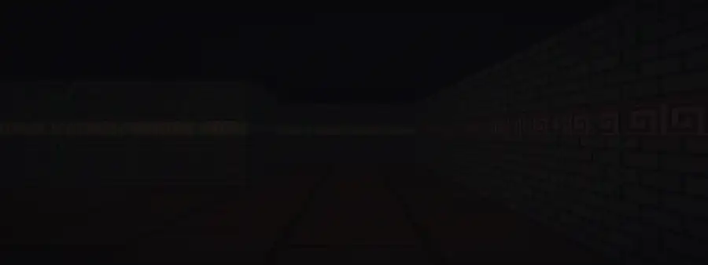
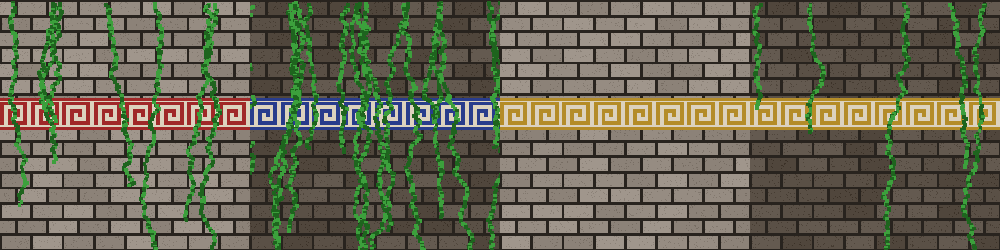

# minos3D

A raycaster in C and MiniLibX, built for the 42 cub3D subject and set in a Greek labyrinth.



<sub>The spiral map <code>maps/minos.cub</code> with the <code>textures-minos/</code> walls. Frames re-rendered offline with the same DDA algorithm.</sub>

## Run it

Linux with X11. The Makefile clones [libft](https://github.com/4drie2/libft) and [minilibx-linux](https://github.com/42paris/minilibx-linux) on the first build.

```bash
make
./cub3d maps/minos.cub
```

| Key | Action |
|---|---|
| W A S D | move |
| ← → or mouse | turn |
| Shift (hold) | move faster |
| Esc | quit |

## How it draws a frame

For every column of the 1400×800 window, a ray leaves the player and steps through the grid one cell boundary at a time (DDA) until it hits a wall. The perpendicular distance to that wall gives the height of the column; the side that was hit (north, south, east, west) picks the texture, and the exact hit point gives the texture column. Floor and ceiling are filled with the `F` and `C` colours of the map.

## Maps

A `.cub` file holds four texture paths, two RGB colours and the map itself, where `1` is a wall, `0` is floor and `N`, `S`, `E` or `W` is the spawn and its facing.

```
NO ./textures-minos/north.xpm
SO ./textures-minos/south.xpm
WE ./textures-minos/west.xpm
EA ./textures-minos/east.xpm

F 100,60,30
C 5,5,10
```

`maps/` also holds the invalid maps used to test the parser: open walls, two players, no player, bad characters, bad colours. Each one must stop the program with `Error` and a message.



## Authors

[4drie2](https://github.com/4drie2) and [pllrk](https://github.com/pllrk), 42 Le Havre, 2025.
